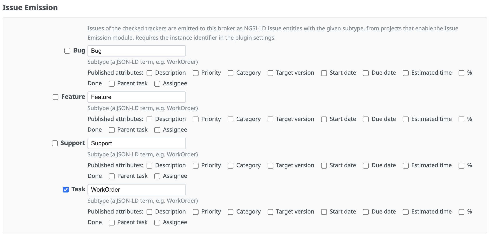

# Issue Emission

Since version 3.1 the plugin can publish issues to an NGSI-LD broker: one
entity per issue, kept up to date when the issue is created, updated, closed
or deleted. Other systems on the broker can then see whether a problem is
being handled, in what state, and where.

Issues are published as entities of the task vocabulary of the
[datamodels.jp](https://datamodels.jp/en/models/task/Task/) catalog, so any
NGSI-LD application written for that vocabulary can read them. The values
follow RFC 8984 (JSCalendar tasks) where the vocabulary does.

The entity type is `Issue`: GTT's `redmine` subject names the model with
Redmine's word. In its context `Issue` expands to the same IRI as
datamodels.jp's `Task` (`https://datamodels.jp/ns/task/Task`), so brokers
store GTT entities exactly like any other `Task`, and a query for `Task`
with the datamodels.jp context finds them. This needs version 0.2.0 or later
of the redmine subject.

## Enabling emission

Three things must be configured; nothing is published until all are in place.

1. **Instance identifier** in the [plugin settings](plugin_settings.md).
2. **Tracker mapping** on an NGSI-LD [connection](broker_connections.md):
   check the trackers to emit and give each a subtype (a JSON-LD term such as
   `WorkOrder` or `RoadDamageReport`).

   
3. **Project module**: enable *GTT FIWARE Issue Emission* in the project's
   settings. Emission is a separate module from the subscriptions module on
   purpose: sharing issue data with a broker is an explicit decision.

Private issues are never emitted. If the broker is unreachable, the failure is
logged and the issue is saved normally. Absent values are left out, never
sent as empty.

An issue created from a notified work order (type `Issue`, `Task` or
`https://datamodels.jp/ns/task/Task`, depending on the subscription's
context) is not emitted, so
two instances that watch each other do not pass the same work order back
and forth.

## What is published

Always published:

| Redmine | Term |
| --- | --- |
| subject | `name` |
| status open / closed | `progress`: `needs-action` / `completed` |
| status name | `statusLabel` |
| tracker mapping | `subtype` |
| issue URL (when a host name is configured) | `source` |
| geometry, when present | `location` (GeoJSON) |
| notification entity, when the issue came from a notification | `refersTo` |
| created, updated | `dateCreated`, `dateModified` |
| issue number | `externalId` (as text, for example `"42"`) |
| project | `project`: a Relationship to `urn:ngsi-ld:Project:redmine:<instance-id>:<project identifier>` |

Published when the checkbox is on in the tracker mapping (all off by
default):

| Checkbox | Term |
| --- | --- |
| Description | `description` |
| Priority | `priority`: a number from 1 to 9, see below |
| Category | `category` (a GTT extension term, see below) |
| Target version | `milestone`: a Relationship to `urn:ngsi-ld:Milestone:redmine:<instance-id>:<version id>` |
| Start date | `start` (a date) |
| Due date | `due` (a date) |
| Estimated time | `estimatedDuration`: an ISO 8601 duration, 1.5 hours → `PT1H30M` (whole minutes) |
| % Done | `percentComplete` |
| Parent task | `parent`: a Relationship to the parent issue's id |
| Assignee | `assignee`: a Relationship to `urn:ngsi-ld:Person:redmine:<instance-id>:<user id>`, or `urn:ngsi-ld:Group:redmine:<instance-id>:<group id>` for a group |

**Published custom fields** are also set per tracker mapping: each with its
own term name, typed by the field's format, in the instance's own
vocabulary.

Details:

- **Priority**: the issue's priority is placed among the *active* Redmine
  priorities and spread evenly over 1 to 9: the highest priority is 1, the
  lowest is 9, the others in between (rounded). With Redmine's five default
  priorities: Immediate 1, Urgent 3, High 5, Normal 7, Low 9. The value is 0
  ("undefined" in RFC 8984) when there is only one active priority, or when
  the issue's priority is no longer active.
- **Assignee** is a multi-valued Relationship, so it is sent as a list with
  one entry and the `datasetId` `urn:ngsi-ld:dataset:assignee:1`. It contains
  the user's or group's id, not the name. Publishing it is an explicit
  decision.
- **Project and milestone**: only the Relationship is published. The
  `Project` and `Milestone` entities themselves are not emitted (yet); the
  ids are stable and safe to use as keys.
- **Start and due** are plain dates (`{"@type": "Date", "@value":
  "2026-07-30"}`), as Redmine has no time of day for them.

## Authentication

Emission runs on the server, so it can only authenticate with a connection's
*stored* token. Connections without a token emit unauthenticated, which works
for open brokers.

## Public identity and the entity id

Entity ids follow `urn:ngsi-ld:Issue:redmine:<instance-id>:<issue-id>` and
stay stable for the life of the issue. The `Issue` in the id is historical:
earlier versions published `Issue` entities, and the ids were kept so that
no entity is re-identified.

When **Administration → Settings → Host name** is configured, emitted entities
reference the instance's own context document (see below). Without a host
name, they reference the redmine subject's public context instead; the task
terms keep their meaning, and instance subtypes and custom fields fall back
to the default vocabulary. For federation, configure the host name.

## The published schema

- GTT's data model node publishes the `redmine` subject
  (<https://models.gtt-project.org/ns/redmine>). Its context,
  <https://models.gtt-project.org/context/redmine/v0.jsonld>, imports the
  datamodels.jp task context and adds `Issue` (the same IRI as `Task`) and
  `category`.
- Each instance serves `GET /fiware/task-context.jsonld` (public). Its
  `@context` is that GTT context plus the instance's own terms: the subtypes
  and the published custom fields. Its `@graph` declares each subtype a
  subclass of `https://datamodels.jp/ns/task/Task`. Reading this one URL is
  enough to interpret the instance's entities.
- Entities reference the instance's context followed by the NGSI-LD core
  context.

### Reserved terms

A subtype or a custom field term may not be one of the task vocabulary's
terms (for example `Issue`, `Task`, `Project`, `Milestone`, `name`,
`progress`, `due`, `start`, `keywords`, `category`), a context prefix
(`rdf`, `rdfs`, `inst`) or an NGSI-LD term (`id`, `type`, `location`, `dateCreated`,
`dateModified`, `dateObserved`), in any upper or lower case. Mappings saved
earlier with such a term must be renamed before the connection form can be
saved again. Until then, such a custom field is not published, and such a
subtype is still sent as the `subtype` value but is not defined in the
instance context.

## Entities from earlier versions

Earlier versions could publish `Issue` entities in the GTT core vocabulary
(`https://gtt-project.org/ns/fiware`). That vocabulary is retired. Its
`Issue` has the same short name but a different IRI
(`https://gtt-project.org/ns/fiware#Issue`, or
`https://uri.etsi.org/ngsi-ld/default-context/Issue` when emitted without a
host name). Such an entity still on a broker is replaced on the issue's next
update: it has the same id, so the plugin deletes it and creates it again
with the current type, because NGSI-LD cannot change the type of an entity
in place. Issues that are not updated keep their old entity until then;
delete those on the broker if you do not want to wait.

## Issues as NGSI-LD on demand

Every issue is also available as an NGSI-LD entity at
`GET /fiware/issues/<id>/entity` (session or API key). Like emission itself,
this needs the instance identifier to be set; without it the endpoint answers
404 and the link is not shown. The issue page links to it from its
"Also available in" list, next to PDF and Atom. This returns the same
representation the emitter publishes.
